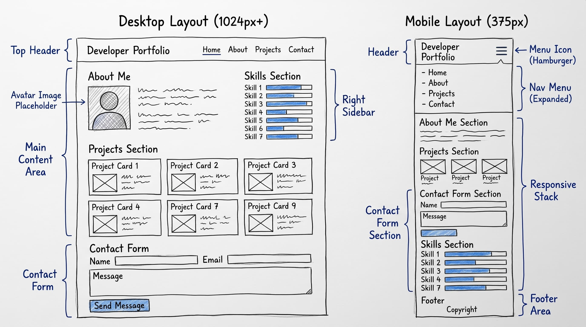
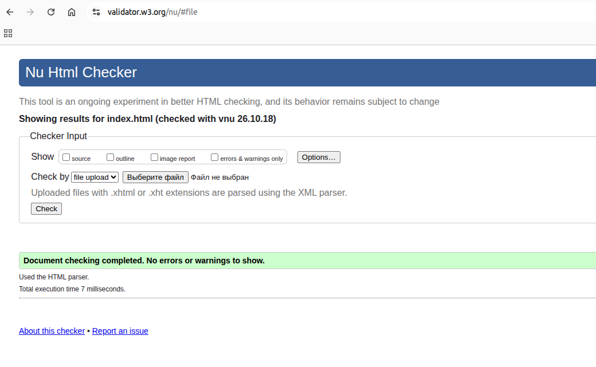
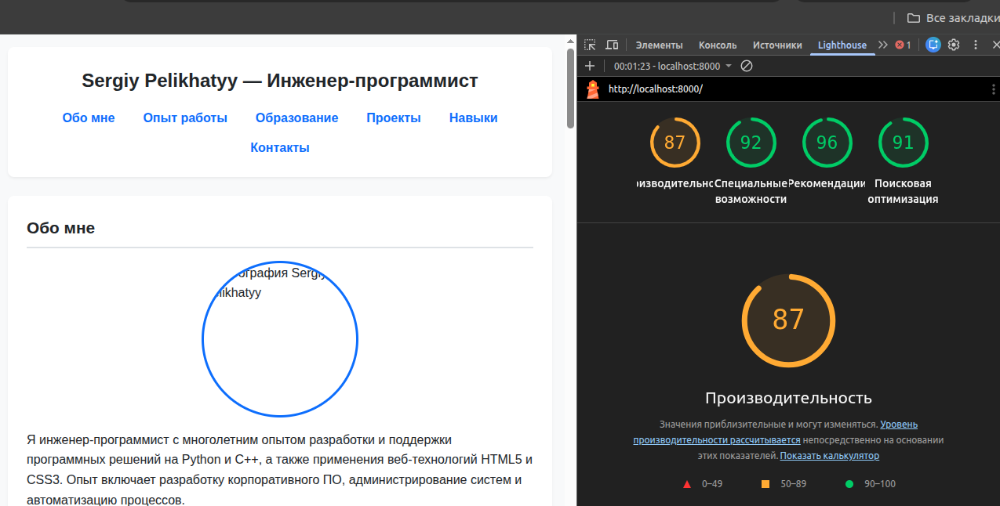
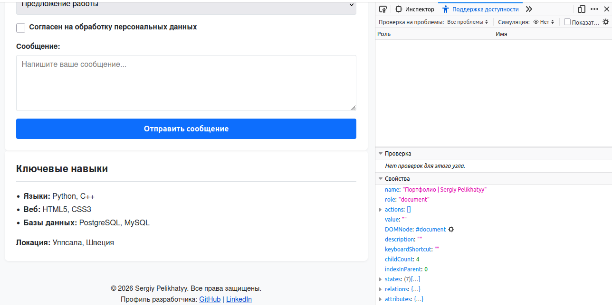

# Портфолио веб-разработчика | Sergiy Pelikhatyy

Персональный веб-сайт-портфолио, созданный в рамках учебного задания. Проект представляет собой адаптивную веб-страницу с информацией об опыте разработки, ключевых навыках, сертификатах и форме обратной связи.

---

## 🚀 Демонстрация (GitHub Pages)

Сайт опубликован и доступен по адресу:  
👉 **[[Ссылка на GitHub Pages](https://segr1970-netizen.github.io/web-portfolio/)](#)** *(вставьте вашу ссылку на GitHub Pages)*

---

## 🛠️ Технологии и особенности

- **HTML5**: Семантическая разметка (`<header>`, `<nav>`, `<main>`, `<section>`, `<article>`, `<aside>`, `<footer>`).
- **CSS3**: Использование CSS Variables, Flexbox и CSS Grid.
- **Mobile-First Responsive Design**: Адаптивная верстка под мобильные устройства, планшеты и ПК (Media Queries).
- **Accessibility (a11y)**: Высокая доступность, контрастные цвета, связь тегов `<label>` с элементами формы.
- **W3C Standards**: Соответствие стандартам валидности кода.

---

## 📁 Структура проекта

```text
.
├── index.html          # Главная страница портфолио
├── style.css           # Таблица стилей
├── avatar.jpg          # Фотография профиля
├── README.md           # Документация проекта
└── screenshots/        # Скриншоты эскизов и результатов тестирования
    ├── wireframe.png
    ├── w3c-validator.png
    ├── lighthouse.png
    └── firefox-a11y.png
```

---

## 📐 Эскиз макета (Wireframe)

Перед началом разработки был создан эскиз будущей страницы для мобильных устройств и экранов ПК:



### Описание структуры макета:
- **Мобильная версия**: Одноколоночная структура (`Mobile-First`). Элементы расположены вертикально: шапка с навигацией, блок «Обо мне», карточки проектов, форма контактов и боковая панель с навыками.
- **Десктопная версия**: Двухколоночная сетка (`CSS Grid`). Основной контент занимает левую часть, а боковая панель (`<aside>`) с ключевыми навыками выносится в правую колонку.

---

## 🧪 Тестирование и валидация

### 1. W3C HTML Validator
Проверка кода на отсутствие синтаксических ошибок и соблюдение спецификации HTML5.


### 2. Google Chrome Lighthouse
Анализ производительности, доступности (Accessibility), соблюдения Best Practices и SEO.


### 3. Firefox Accessibility Tools
Проверка дерева доступности, семантики и контрастности элементов.


---

## 👤 Автор

**Sergiy Pelikhatyy** — Инженер-программист (Уппсала, Швеция)
- GitHub: github.com
- LinkedIn: linkedin.com
